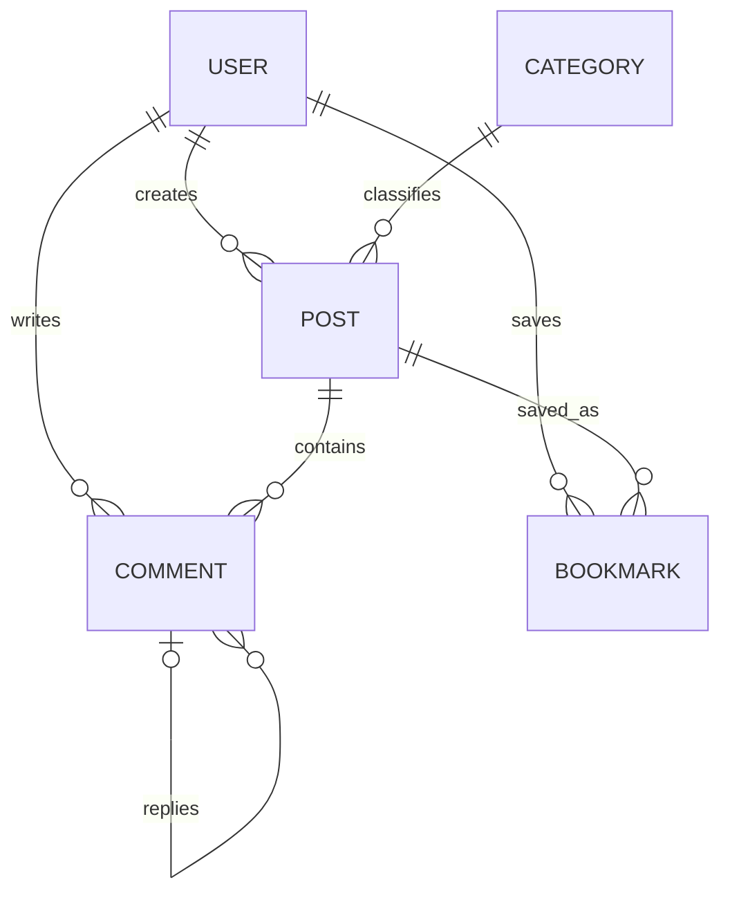
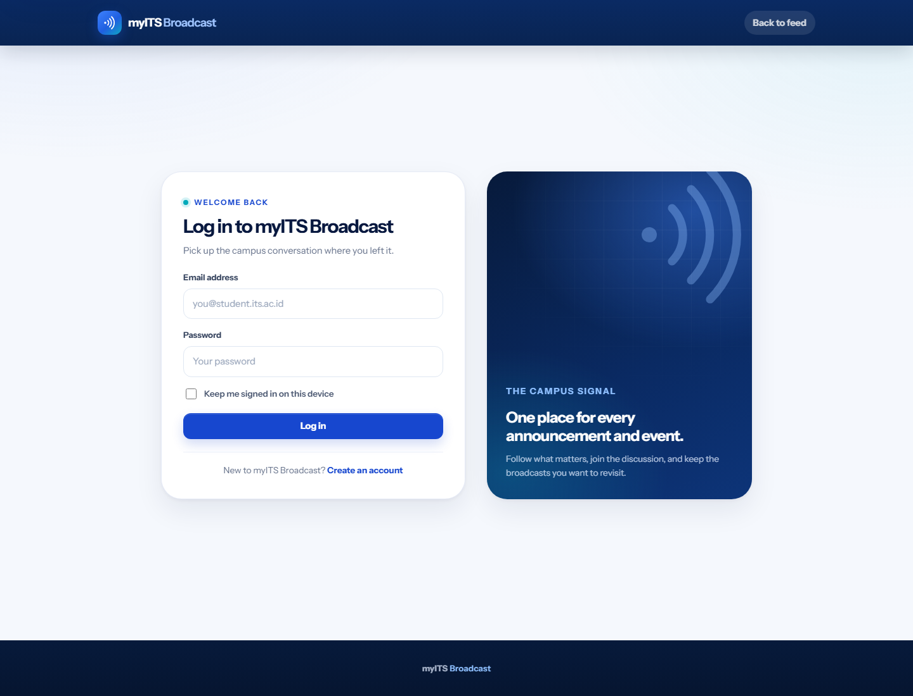
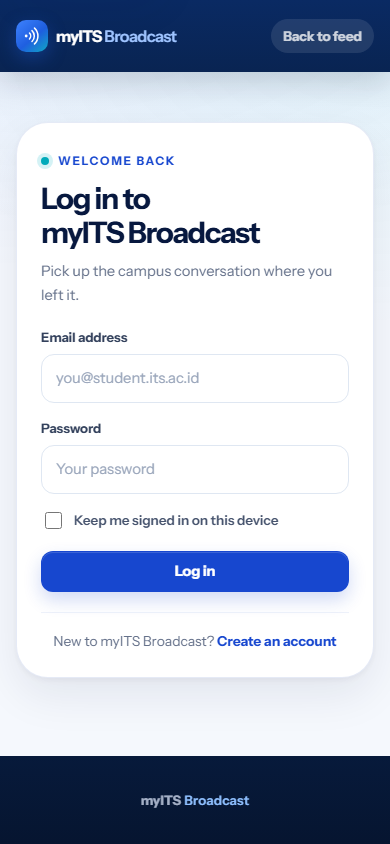
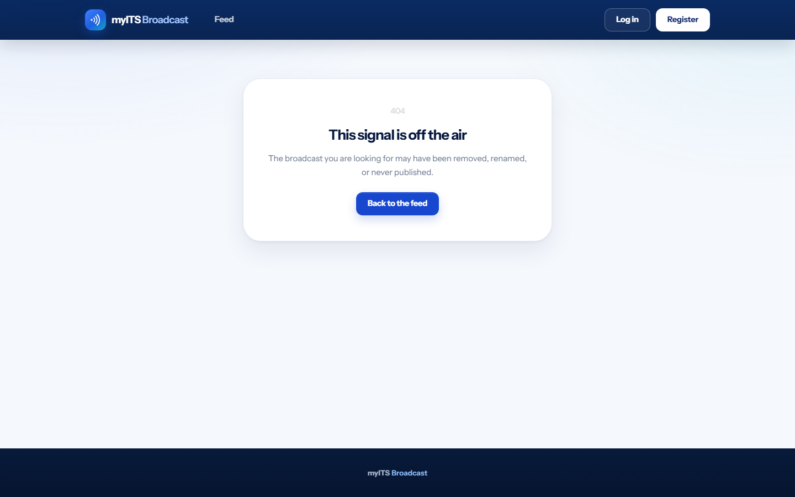
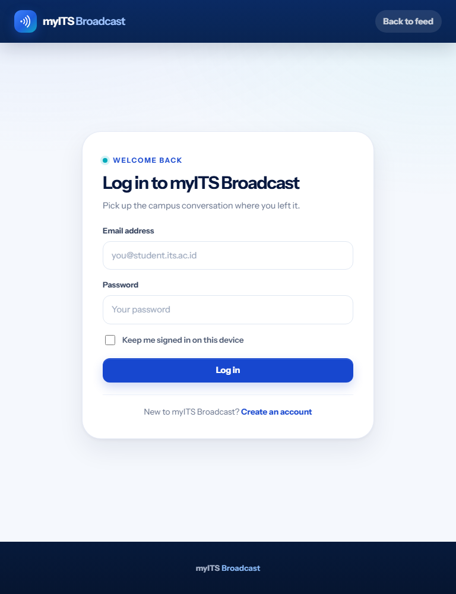
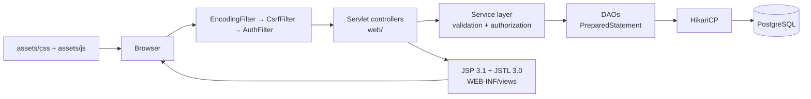

# myITS Broadcast — Migration Report

## Title page

| Item | Value |
|---|---|
| Project | **myITS Broadcast** — campus announcement and event broadcaster |
| Course | Web Programming — Quiz 2 `[confirm course name/code]` |
| Class | `[class / section]` |
| Group | `[group name/number]` |
| Live URL | `[https://... — not deployed yet]` |
| GitHub repository | `[https://github.com/... — add after pushing]` |
| Runtime | Java 17 · Jakarta EE 10 · JSP 3.1 · Servlet 6.0 · JSTL 3.0 · Tomcat 10.1 · PostgreSQL |
| Build | Maven WAR (`target/myitsbroadcast.war`) |

> The live URL and GitHub URL are placeholders. The application has **not** been
> deployed, and no PostgreSQL import has been executed.

---

## 1. Product overview

myITS Broadcast is a campus bulletin board for the Institut Teknologi Sepuluh Nopember
(ITS) community. It publishes announcements and event information in a public,
newest-first feed. Visitors can search by keyword and filter by category or post type.
Signed-in users can publish announcements or events, save drafts, upload a cover image,
comment and reply in a one-level thread, bookmark posts, and manage their own posts from
a personal dashboard. Account settings cover registration, login, profile and avatar
editing, password changes, and account deletion.

The product is a **broadcaster**, not an event-management system. Event posts show the
event's date, time, and location, but there is no registration, RSVP, attendee list, or
enrollment workflow anywhere in the application, schema, or importer.

This repository contains both the original Laravel implementation and the replacement
Jakarta JSP application. The JSP application is the final deliverable; the Laravel tree
and `database/database.sqlite` remain as a recoverable behavioral/data reference.

---

## 2. Conceptual data model

Full document: [`erd-conceptual.md`](erd-conceptual.md).



The model has five product entities:

- **User** authors posts and comments and owns bookmarks.
- **Category** is seeded reference data used for filtering; it is not user-managed.
- **Post** is an announcement or event, owned by one user and classified by one category.
- **Comment** belongs to a post and an author; `parent_id` creates one reply level.
- **Bookmark** is a unique user–post association.

There is deliberately **no Event registration entity**, and no password-reset token
entity: password changes happen from account settings.

---

## 3. Physical data model

Full document: [`erd-physical.md`](erd-physical.md). Source: `src/main/resources/db/schema.sql`.

| Table | Purpose | Key constraints |
|---|---|---|
| `users` | Accounts | PK `id`; unique `email`; cascade to posts/comments/bookmarks |
| `categories` | Campus categories | PK `id`; unique `name`, `slug`; `RESTRICT` from posts |
| `posts` | Announcements/events | PK `id`; unique `slug`; FKs to users/categories; type/status CHECKs |
| `comments` | Threads and replies | PK `id`; FKs to posts/users/comments; non-blank body CHECK |
| `bookmarks` | Saved posts | PK `id`; unique `(user_id, post_id)` |

Important physical details:

- `comments.parent_id` is nullable and self-referencing, preserving the one-level reply
  structure.
- `posts` retains `is_pinned` for data compatibility but no UI or ordering uses it.
- `posts.status` allows `draft`, `published`, `archived`; the feed exposes only published
  rows whose `published_at` is not null and not in the future.
- `users.is_moderator` is preserved but grants no extra powers; the source policies are
  author-only.
- `email_verified_at` is absent. Email verification is not part of the product.
- `password_reset_tokens` is absent. Password reset is removed from the product.
- `event_registrations` is absent. No table, FK, index, or import.

Indexes cover the feed (`status, published_at`), category filtering
(`category_id, published_at`), type filtering, ownership, comment threads, and bookmark
uniqueness.

---

## 4. Feature list

| # | Capability | What it does |
|---|---|---|
| 1 | Public feed | Published announcements/events, newest first, 9 per page |
| 2 | Search | Case-insensitive keyword match over title and body |
| 3 | Filters | Category and post type, combinable with search; clear-filter link |
| 4 | Post detail | Title, type/category, author, date, cover, body, comments, bookmark control |
| 5 | Event metadata | Start/end date-time and location, only for event posts |
| 6 | Create post | Announcement or event; draft or published; optional cover image |
| 7 | Edit post | Owner-only; title/slug refresh, cover replace/remove, publish/draft transitions |
| 8 | Delete post | Owner-only; removes the post and its cover file |
| 9 | Comments | Signed-in users comment on published posts |
| 10 | Replies | One-level replies; replies to replies attach to the top-level comment |
| 11 | Edit comment | **The only approved addition**: author-only inline edit, server-validated |
| 12 | Delete comment | Author-only; replies cascade |
| 13 | Bookmarks | Toggle add/remove; duplicate-safe; JSON for fetch, redirect fallback |
| 14 | Dashboard | Own posts, total/published/draft counts, bookmarked posts, management links |
| 15 | Registration | Immediate access; no email verification |
| 16 | Login/logout | Throttled login; session fixation protection; remember-me; logout outside navbar |
| 17 | Profile | Name, email, avatar upload/removal |
| 18 | Password change | Recent-password confirmation gate |
| 19 | Account deletion | Current password required; cascades the user's data |
| 20 | Uploads | JPEG/PNG/WebP, 2 MB, magic-byte validation, UUID names, persistent storage |
| 21 | Health probe | `/health` JSON for deployment checks |

No notifications, messaging, reactions, follows, admin dashboard, analytics, new post
types, category administration, pinned-post UI, password reset, or event registration
were added.

---

## 5. C/R/U/D compliance matrix

This matrix is based on real operations in the JSP code. “—” means the operation is not
part of the current product; it is not a hidden gap that was papered over.

| Resource / capability | Create | Read | Update | Delete | Notes |
|---|---|---|---|---|---|
| **Posts** | ✅ create form | ✅ feed, detail, dashboard | ✅ owner-only edit | ✅ owner-only delete | Full CRUD. Draft/published/archived status; cover upload/remove; event metadata |
| **Comments / replies** | ✅ comment and reply | ✅ post thread | ✅ author-only edit | ✅ author-only delete | Full CRUD. Replies flattened to one level; edit is the approved addition |
| **Users / profile** | ✅ registration | ✅ profile and author byline | ✅ profile, avatar, password | ✅ account deletion | Full CRUD. Password confirmation on deletion; recent-password gate on security |
| **Bookmarks** | ✅ add/toggle | ✅ dashboard list and count | — | ✅ remove/toggle | Toggle is add/remove; there is no meaningful “update” for an association |
| **Categories** | — | ✅ select and filter | — | — | Read-only by design; the source has no category admin |
| **Post cover images** | ✅ upload | ✅ rendered | ✅ replace | ✅ remove | Part of post management |
| **Avatars** | ✅ upload | ✅ rendered | ✅ replace | ✅ remove | Part of profile management |
| **Sessions** | ✅ login | — | — | ✅ logout | Authentication, not a product resource |

### Does this meet “at least 8 CRUD features”?

**Yes, under the operation-count interpretation.** Posts alone provide four operations
(C/R/U/D), comments provide four, and bookmarks, users/profile, covers, avatars, and reset
tokens add more. The implemented operations comfortably exceed eight.

**Disclosure:** if the lecturer means *eight separate resource types, each with full
C/R/U/D*, the existing broadcaster scope does not meet that reading. Only posts, comments,
and users/profile have full CRUD; categories are read-only by design; bookmarks have no
update operation. Reaching “eight full-CRUD resources” would require inventing new
resources or workflows, which the build prompt explicitly forbids. This is flagged rather
than inflated.

### Per-feature explanations

- **Feed and pagination.** `PostDao.publishedPage` filters `status = 'published'`,
  `published_at IS NOT NULL`, and `published_at <= now`, orders by `published_at DESC,
  id DESC`, and applies `LIMIT/OFFSET`. The page size is 9.
- **Search and filters.** Keyword, category slug, and type are bound as prepared-statement
  parameters. Pagination links rebuild the current query string.
- **Post detail and drafts.** `PostService.findVisible` returns a post when it is published
  or when the viewer is its author. Event fields render only for `type = event`.
- **Post management.** Owners create, edit, and delete their own posts. Publishing sets
  `published_at`; reverting to draft clears it. A title change regenerates a unique slug.
  Cover replacement deletes the previous file after the new one is stored.
- **Comments and replies.** `CommentService.create` verifies that the parent belongs to the
  same post and flattens a reply-to-reply to the top-level parent. Only the author may edit
  or delete; moderators gain no new rights because the source policy is author-only.
- **Comment editing.** The inline editor posts `_method=PUT` to `/comments/{id}`. The
  service validates a non-empty body of at most 2,000 characters, updates only `body` and
  `updated_at`, preserves ownership/parentage, and redirects back to the thread with a
  flash message. Tests cover own comment, own reply, empty body, unauthenticated update,
  and another user's comment.
- **Bookmarks.** The unique `(user_id, post_id)` index makes repeated clicks harmless. The
  servlet returns JSON to fetch requests and a redirect to normal form posts.
- **Dashboard.** Counts are computed from the user's real rows; no metric is cached or
  invented. Archived posts remain in totals but are not published.
- **Authentication.** Registration logs the user in immediately. Login is throttled at 5
  attempts per 60 seconds per email+IP, rotates the session id, and can issue a hashed
  remember-me cookie. Logout invalidates the session.
- **Password change.** Passwords are changed only from account settings after confirming
  the current password. There is no self-service reset flow, no token table, and no email
  delivery in the application.
- **Profile and account.** Name/email are validated and unique; avatars are validated by
  magic bytes and stored under `APP_STORAGE_DIR`. Password change requires a recent
  password confirmation. Account deletion requires the current password and cascades.
- **Uploads.** Only JPEG, PNG, and WebP up to 2 MB are accepted. Filenames are UUIDs and
  paths are resolved beneath the storage directory, blocking traversal.

---

## 6. Screenshots of the running JSP application

These screenshots were captured from the WAR deployed on **Apache Tomcat 10.1.34** at
`http://localhost:18080`, at 1440 px desktop, 768 px tablet, 390 px mobile, and 360 px
sanity-check widths.

### Design refinement in this pass

- **Feed.** The page now opens with an editorial masthead — “Latest from across ITS.” —
  paired with a dark signal band. The first post on the unfiltered first page becomes a
  wide featured card, so the grid no longer reads as nine identical tiles. Search and
  filters sit on one line at desktop and reflow deliberately on mobile.
- **Home navigation.** The home masthead shows one navbar only; once the page scrolls
  past 180 px, a compact fixed bar slides in from the top and leaves again on the way
  back up, matching the legacy build.
- **Post detail.** The metadata rail is sticky on desktop, body text is capped at a
  comfortable reading measure, and the first paragraph is set slightly larger as a lede.
- **Comments.** Top-level comments are now hairline-separated discussion rows instead of
  repeated cards; replies sit behind a quiet blue rail. The composer remains a card so it
  still reads as an action surface.
- **Dashboard.** One stat card is anchored in deep blue while the rest carry quiet accent
  rules, giving the four numbers a clear starting point without changing their meaning.
- **Controls and settings.** Primary buttons are solid blue rather than gradient, control
  corners are tighter, panel headings carry a rule, and the settings navigation sticks
  while the form scrolls.
- **Responsive.** The masthead stacks and the signal card becomes a full-width band at
  860 px and below; the featured card collapses to a normal vertical card below 640 px,
  and the filter controls stack. No horizontal overflow at 390 or 360 px in the fixture
  or on the deployed auth and error pages.

Live captures of the feed, detail, dashboard, compose and settings screens still require
PostgreSQL; the CSS and JSP markup for those screens were validated through JSP
precompilation and representative browser fixtures, not through a database-backed run.

### Login (desktop)



Email/password form, remember-me, registration link, and the
blue-first auth layout. The shared header has no Logout control and there is no reset
link.

### Login (mobile, 390 px)



The auth layout collapses to one column without horizontal overflow; controls remain
comfortably tappable.

### Registration (desktop)


Name, email, password, and confirmation. The copy states that the account works right
away — there is no verification step.

### Registration (mobile, 390 px)


### 404 error page



A real unknown URL renders the JSP error page inside the shared layout, with the footer
showing only the wordmark.

### 404 error page (mobile)


### 404 error page (360 px sanity check)


The guest header and error card were measured with browser devtools at 390 px and 360 px.
`document.documentElement.scrollWidth` equals the viewport width at both sizes, so there is
no horizontal overflow. The footer stays at the bottom of short pages.

### Login (tablet, 768 px)



The auth aside is hidden below 860 px and the card centres at a comfortable reading width.

### 500 error page


This is the JSP 500 page rendered when the feed attempts to reach PostgreSQL without
credentials. It is shown as evidence that the error path works; it is **not** a product
screen. The database-backed pages could not be captured because the user did not approve
a PostgreSQL connection or import.

### Screenshot limitation (disclosed)

Feed, post detail, dashboard, post form, comments, bookmarks, and settings screenshots
require a live PostgreSQL database. They are **not** included, and concept-board mockups
were **not** substituted as implementation evidence. Once the user approves database
credentials and runs `schema.sql` + the importer, those pages can be captured with the
same Tomcat deployment.

---

## 7. Technology and architecture



- **Servlets** map the existing route groups: feed, posts, comments, bookmarks, dashboard,
  auth, profile/avatar, account, security, uploads, health.
- **Services** hold the business rules and authorization checks.
- **DAOs** use `PreparedStatement` only; values are never concatenated into SQL.
- **HikariCP** opens the pool lazily, so Tomcat can start and render a clear error page
  even when PostgreSQL is unavailable.
- **JSP/JSTL** render views under `WEB-INF/views`, which cannot be requested directly.
  Tag files provide the avatar, post card, and pagination components.
- **Filters** apply UTF-8, CSRF validation, and authentication/guest-only routing.
- **Assets** are plain CSS and vanilla JS. Instrument Sans is bundled locally from the
  project's existing font files; no remote font dependency is used.
- **Uploads** are stored under `APP_STORAGE_DIR` and streamed by `UploadServlet`; the WAR
  can be redeployed without deleting user images.

### Dependencies and why they exist

| Dependency | Purpose |
|---|---|
| `jakarta.servlet-api` 6.0.0 (provided) | Servlet API supplied by Tomcat |
| `jakarta.servlet.jsp-api` 3.1.0 (provided) | JSP API supplied by Tomcat |
| JSTL 3.0 API + Glassfish impl | JSTL tags/functions in JSPs |
| HikariCP 5.1.0 | Connection pool |
| PostgreSQL JDBC 42.7.4 | PostgreSQL driver |
| jBCrypt 0.4 | BCrypt password hashing |
| SLF4J 2.0.13 + jdk14 | HikariCP logging binding |
| SQLite JDBC 3.46.1.3 | Read-only legacy importer only |
| JUnit 5.10.2 | Unit/smoke tests |
| Tomcat embed 10.1.34 + Ant 1.10.14 (test) | Embedded smoke test and JSP precompilation |

---

## 8. DOMCloud readiness

The application is **not deployed**. The repository contains a documented deployment path
plus a locally exercised start command, not a claim that DOMCloud has run it.

Official references used:

- <https://domcloud.co/docs/deployment/java>
- <https://domcloud.co/docs/deployment/deploy>
- <https://domcloud.co/docs/deployment/nginx>

### Configuration

`domcloud.yml` is a sample deployment script. It:

1. enables `java 17` and `postgresql`;
2. clones the repository into `~/public_html`;
3. downloads Maven 3.9.9 into the account and builds the WAR;
4. writes a server-side `.env.jsp` from DOMCloud's `$DATABASE`, `$USERNAME`,
   `$PGPASSWD`, and `$DOMAIN` variables; the name is distinct from the legacy Laravel
   `.env` so the two runtimes cannot read each other's settings;
5. points NGINX at an empty `static/` directory so repository sources are not served;
6. starts Tomcat through Passenger with `app_start_command: bash scripts/domcloud-start.sh`.

`scripts/domcloud-start.sh`:

- loads `.env.jsp`;
- refuses to start in production without `DB_URL`, `DB_USER`, `DB_PASSWORD`, and
  `APP_BASE_URL`;
- downloads Tomcat 10.1.34 into `~/.local` if it is not installed (DOMCloud does not
  preinstall Tomcat just because Java is enabled);
- writes a minimal `server.xml` bound to `$PORT` on `127.0.0.1` (override with
  `BIND_ADDRESS`), with no shutdown port and no AJP;
- deploys `target/myitsbroadcast.war` as `ROOT.war`;
- runs Tomcat in the foreground with UTF-8 and `Asia/Jakarta`.

### Local verification of the start command

The start script was executed with an explicit test port and a separate `CATALINA_BASE`,
using Git Bash on the development machine:

```text
PORT=18081 BIND_ADDRESS=127.0.0.1 bash scripts/domcloud-start.sh

Starting myITS Broadcast on port 18081 (CATALINA_BASE=.../domcloud-tomcat)
Deploying web application archive [.../webapps/ROOT.war]
Server startup in [1170] milliseconds

GET http://127.0.0.1:18081/health → 200 {"status":"ok","application":"myitsbroadcast"}
GET http://127.0.0.1:18081/login  → 200 text/html
```

The generated connector was `port="18081" address="127.0.0.1"`, and the deployed WAR was
the same WAR artifact produced by Maven. This verifies the start-script logic
and the WAR deployment; it does **not** verify DOMCloud's plan, Passenger wiring, or the
remote PostgreSQL service.

### First-deploy checklist

1. Push the repository to GitHub and replace the `source:` placeholder.
2. Paste `domcloud.yml` into Setup → Deploy, or configure the same values manually.
3. After the first deploy, run the idempotent schema once over SSH:
   ```bash
   PGPASSWORD="$PGPASSWD" psql -h localhost -U "$USERNAME" -d "$DATABASE" \
     -f ~/public_html/src/main/resources/db/schema.sql
   PGPASSWORD="$PGPASSWD" psql -h localhost -U "$USERNAME" -d "$DATABASE" \
     -f ~/public_html/src/main/resources/db/seed.sql
   ```
4. If migrating legacy data, build the importer and run it with the destination
   credentials in the environment. Take a backup first. The importer is idempotent by
   primary key and skips event registrations.
5. Smoke test `/health`, `/login`, `/register`, `/assets/css/app.css`, and an unknown URL.
6. Keep `APP_STORAGE_DIR` outside the deploy/build directory and back it up separately.

### Unverified hosting constraints

- **Plan eligibility:** the assignment asks for free hosting. The sample assumes the
  selected DOMCloud plan allows the `java` and `postgresql` features and Passenger app
  startup. This was not verified against the user's account or plan.
- **Tomcat install time:** the first start downloads Tomcat; later starts reuse
  `~/.local/apache-tomcat-10.1.34`.
- **Build time:** the deployment script downloads Maven and builds the WAR within
  DOMCloud's 15-minute deployment limit. A warm cache makes later deploys faster.
- **Mail:** the application sends no email; password reset is not part of the product.
- **No Docker assumption:** the deployment uses a WAR/Tomcat start script, not Docker.

---

## 9. Verification and honest status

### Commands run

```text
java -version            → 17.0.21.1
javac -version           → 17.0.21.1
mvn -version             → Apache Maven 3.9.9
mvn -q test              → 50 tests, 0 failures, 0 errors
mvn -q package           → BUILD SUCCESS
                           target/myitsbroadcast.war
                           target/myitsbroadcast-importer.jar
```

### Three different kinds of “verification”

| Kind | Status | Evidence |
|---|---|---|
| **Schema validation** | PASSED (structural) | `SchemaTest` asserts the required tables/columns exist in `schema.sql` and that `event_registrations`, `password_reset_tokens` and `email_verified_at` do not. `seed.sql` is idempotent. The schema has **not** been applied to a live PostgreSQL server. |
| **Compilation/build** | PASSED | `mvn test` and `mvn package`; Jasper precompiled every JSP with `Generation completed with [0] errors`. |
| **Actual database migration** | **NOT PERFORMED** | No PostgreSQL connection, no `schema.sql` execution, no importer run against PostgreSQL. The user withheld credentials and approval. |

### Tomcat smoke evidence

```text
Server version: Apache Tomcat/10.1.34
Server startup in [1203] milliseconds

GET /health                                  → 200 application/json
GET /login                                   → 200 text/html
GET /register                                → 200 text/html
GET /forgot-password                         → 404 (feature removed)
GET /assets/css/app.css                      → 200 text/css
GET /assets/fonts/instrument-sans-400.woff2  → 200 font/woff2
GET /assets/img/signal.svg                   → 200 image/svg+xml
GET /this-page-does-not-exist                → 404 (JSP error page)
GET /                                        → 500 (JSP error page; PostgreSQL unavailable)
```

### Importer dry run

```text
users              14
categories          6
posts              15
comments            9
bookmarks           5
event registrations 5 (skipped by design)
Dry run complete. No PostgreSQL connection was opened and nothing was written.
```

### Bugs found and fixed during verification

- `feed.jsp` used `${posts.empty}`, which is invalid EL (`empty` is a reserved operator).
  Jasper refused to compile the page. Fixed to `${empty posts.items}`.
- `PostDao` appended the viewer's `bookmarked` column after the `FROM` clause, which would
  have produced invalid SQL for signed-in users. Fixed by separating `COLUMNS`, `FROM`, and
  the viewer-specific projection.
- `posts/show.jsp` used `fn:split(post.body, '\n')`, which Jasper rejects. Replaced with
  `<c:forTokens>` over line breaks.
- Embedded Tomcat had no default MIME mappings, so CSS was served without `text/css`.
  Added explicit mappings to `web.xml`.
- The initial mobile screenshot was clipped because headless Chrome enforces a minimum
  window width. Re-captured with CDP device emulation at a true 390 px viewport.
- The guest header overflowed at 390 px and 360 px: the wordmark plus Log in/Register
  needed more width than the viewport, which widened the mobile layout viewport and cut
  the error card off. The compact header now uses a smaller wordmark and compact guest
  buttons below 640 px, with wrapping as a fallback. Devtools measurement confirms
  `scrollWidth == viewport` at 390 px and 360 px.
- The footer did not sit at the bottom on short pages. The body is now a flex column with
  a growing `<main>`, so the footer is anchored to the bottom without changing long pages.

These are recorded because they are real defects found by the verification loop, not
polish claims.

### Known limitations

1. **No live database verification.** Feed, detail, dashboard, post CRUD, comments,
   bookmarks, and settings are implemented and unit-tested where possible, but not
   exercised end-to-end against PostgreSQL.
2. **No DB-backed screenshots.** Disclosed in §6; no mockups substituted.
3. **No automated accessibility audit.** Contrast and focus were designed and checked
   visually; axe/Lighthouse was not run.
4. **320 px not separately captured.** 1440 px, 768 px, 390 px, and 360 px were checked;
   CSS breakpoints cover 1040/860/640 px.
5. **PDF report not generated.** The Markdown report is complete; no reliable
   Markdown/Mermaid-to-PDF toolchain was available.
6. **2FA/passkeys not ported.** No working user-facing flow exists in the source.

---

## 10. Group contributions

Names, student IDs, and role descriptions below are carried from the repository's original
README. Percentages and the exact split of JSP-migration work must be confirmed by the
group. They are intentionally left as placeholders rather than invented.

| Member | Student ID | Role / job description | Contribution details | % |
|---|---|---|---|---|
| Marvel Timothy N. | 5025251209 | Backend, database design, authentication | `[confirm JSP-specific contribution]` | `[__%]` |
| Joel Angga Fransmartua Manalu | 5025251212 | Features, testing, final report | `[confirm JSP-specific contribution]` | `[__%]` |
| Syabil Zihni | 5025251217 | Frontend, UI/UX, project documentation | `[confirm JSP-specific contribution]` | `[__%]` |
| **Total** | | | | **100% once filled** |

If the group membership changed for Quiz 2, replace these rows. Do not submit percentages
that do not total 100%.

---

## 11. Academic integrity

This report describes work performed in this repository. It does **not** contain a signed
academic-integrity declaration. Each member must write and sign their own declaration
accurately, including any assistance received. The report deliberately distinguishes
implemented, unverified, and not-implemented items.
