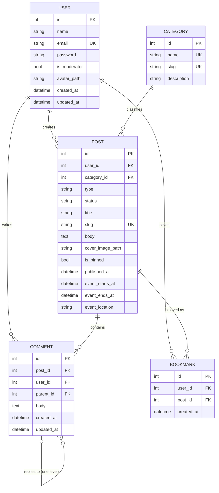

# Conceptual data model (CDM)

myITS Broadcast is a campus broadcaster. The conceptual model contains five product
entities — **User**, **Category**, **Post**, **Comment**, **Bookmark**. Event
registration and password reset are intentionally absent.

## Relationship explanation

- **User → Post (1:N).** A user may author many announcements and events. Each post has
  exactly one author. Deleting an account cascades to its posts.
- **Category → Post (1:N).** Each post belongs to one seeded campus category. Categories
  are reference data and are not editable through the application, so deleting a category
  is restricted while posts reference it.
- **Post → Comment (1:N).** A post owns its discussion thread. Deleting a post deletes its
  comments.
- **Comment → Comment (self, 1:N).** `parent_id` is nullable. Replies are flattened to one
  level: a reply to a reply is stored under the original top-level comment. There is no
  deeper nesting capability.
- **User → Comment (1:N).** Each comment or reply has one author. Only that author may
  edit or delete it.
- **User → Bookmark (1:N) and Post → Bookmark (1:N).** A bookmark is the association
  between one user and one post. The pair is unique, so duplicate bookmarks are impossible.
- **User → Password change.** Passwords are changed from account settings after
  confirming the current password. There is no token table and no self-service reset.
- **No Event registration.** An event post is broadcast information only. Users do not
  register, RSVP, or appear on an attendee list inside myITS Broadcast.

## Scope notes

- `is_pinned` exists for data compatibility but is not surfaced in the feed or dashboard.
- `is_moderator` is preserved but grants no additional powers; the source policies are
  author-only.
- `email_verified_at` is absent. Accounts are usable immediately after registration.
- Two-factor and passkey data are absent because the source has no working user-facing
  flow for them.
