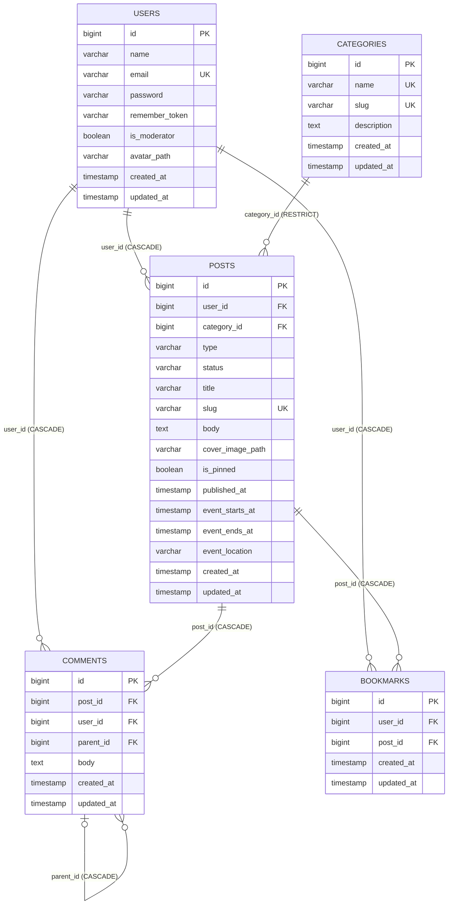

# Physical data model (PDM) — PostgreSQL

Source of truth: `src/main/resources/db/schema.sql`. The schema is idempotent and
non-destructive (`CREATE TABLE IF NOT EXISTS`, `CREATE INDEX IF NOT EXISTS`). It creates
no `event_registrations` table and no `email_verified_at` column.

## Table definitions

### `users`

| Column | Type | Constraints | Description |
|---|---|---|---|
| `id` | `BIGSERIAL` | PK | Preserved legacy id |
| `name` | `VARCHAR(255)` | NOT NULL | Display name |
| `email` | `VARCHAR(255)` | NOT NULL, unique index `users_email_unique` | Login identity; looked up case-insensitively |
| `password` | `VARCHAR(255)` | NOT NULL | BCrypt hash; Laravel `$2y$` accepted |
| `remember_token` | `VARCHAR(100)` | NULL | SHA-256 hash of the persistent-login validator |
| `is_moderator` | `BOOLEAN` | NOT NULL DEFAULT FALSE | Preserved flag; no moderator module |
| `avatar_path` | `VARCHAR(255)` | NULL | Relative path under `APP_STORAGE_DIR` |
| `created_at` | `TIMESTAMP` | NOT NULL DEFAULT Jakarta now | |
| `updated_at` | `TIMESTAMP` | NOT NULL DEFAULT Jakarta now | |

Delete rule: deleting a user cascades to their posts, comments, and bookmarks.

### `categories`

| Column | Type | Constraints | Description |
|---|---|---|---|
| `id` | `BIGSERIAL` | PK | |
| `name` | `VARCHAR(255)` | NOT NULL, unique `categories_name_unique` | e.g. Akademik |
| `slug` | `VARCHAR(255)` | NOT NULL, unique `categories_slug_unique` | Filter key |
| `description` | `TEXT` | NULL | Short description |
| `created_at`, `updated_at` | `TIMESTAMP` | NOT NULL | |

Delete rule: `RESTRICT` from `posts.category_id`; categories are not deletable while used.

### `posts`

| Column | Type | Constraints | Description |
|---|---|---|---|
| `id` | `BIGSERIAL` | PK | |
| `user_id` | `BIGINT` | NOT NULL, FK → `users.id` ON DELETE CASCADE | Author |
| `category_id` | `BIGINT` | NOT NULL, FK → `categories.id` ON DELETE RESTRICT | Category |
| `type` | `VARCHAR(20)` | NOT NULL DEFAULT `announcement`, CHECK in (`announcement`,`event`) | Post type |
| `status` | `VARCHAR(20)` | NOT NULL DEFAULT `draft`, CHECK in (`draft`,`published`,`archived`) | Workflow |
| `title` | `VARCHAR(180)` | NOT NULL | |
| `slug` | `VARCHAR(200)` | NOT NULL, unique `posts_slug_unique` | Public URL key |
| `body` | `TEXT` | NOT NULL | Max 20,000 enforced by the service |
| `cover_image_path` | `VARCHAR(255)` | NULL | Uploaded cover |
| `is_pinned` | `BOOLEAN` | NOT NULL DEFAULT FALSE | Preserved; not surfaced |
| `published_at` | `TIMESTAMP` | NULL | Visibility gate |
| `event_starts_at` | `TIMESTAMP` | NULL | Event only |
| `event_ends_at` | `TIMESTAMP` | NULL | Event only |
| `event_location` | `VARCHAR(255)` | NULL | Event only |
| `created_at`, `updated_at` | `TIMESTAMP` | NOT NULL | |

Indexes:

- `posts_user_id_index (user_id)`
- `posts_category_id_index (category_id)`
- `posts_status_published_at_index (status, published_at)`
- `posts_category_id_published_at_index (category_id, published_at)`
- `posts_type_index (type)`

Visibility: `status = 'published' AND published_at IS NOT NULL AND published_at <= now()`.
Drafts are visible only to their author.

### `comments`

| Column | Type | Constraints | Description |
|---|---|---|---|
| `id` | `BIGSERIAL` | PK | |
| `post_id` | `BIGINT` | NOT NULL, FK → `posts.id` ON DELETE CASCADE | Thread owner |
| `user_id` | `BIGINT` | NOT NULL, FK → `users.id` ON DELETE CASCADE | Author |
| `parent_id` | `BIGINT` | NULL, FK → `comments.id` ON DELETE CASCADE | One-level reply parent |
| `body` | `TEXT` | NOT NULL, CHECK `length(btrim(body)) > 0` | Max 2,000 enforced by the service |
| `created_at`, `updated_at` | `TIMESTAMP` | NOT NULL | Edit updates `body` and `updated_at` only |

Indexes:

- `comments_post_id_index (post_id)`
- `comments_user_id_index (user_id)`
- `comments_parent_id_index (parent_id)`
- `comments_post_id_created_at_index (post_id, created_at)`

Replies are flattened: a reply's `parent_id` always points at the top-level comment.

### `bookmarks`

| Column | Type | Constraints | Description |
|---|---|---|---|
| `id` | `BIGSERIAL` | PK | |
| `user_id` | `BIGINT` | NOT NULL, FK → `users.id` ON DELETE CASCADE | |
| `post_id` | `BIGINT` | NOT NULL, FK → `posts.id` ON DELETE CASCADE | |
| `created_at`, `updated_at` | `TIMESTAMP` | NOT NULL | |

Indexes:

- `bookmarks_user_id_post_id_unique (user_id, post_id)` — duplicate prevention
- `bookmarks_user_id_index (user_id)`
- `bookmarks_post_id_index (post_id)`

## Deliberate omissions

- `event_registrations` — no table, no FK, no import.
- `password_reset_tokens` — password reset is not part of the application; passwords are
  changed from settings with the current password.
- `email_verified_at` — verification is excluded.
- `passkeys`, `two_factor_*` — no working user-facing flow in the source.
- Laravel `sessions`, `cache`, `jobs`, `failed_jobs` — framework infrastructure, not
  product data.

## Timestamp policy

All timestamps are naive `TIMESTAMP` values written in `Asia/Jakarta`, matching the
legacy Laravel configuration. The importer preserves legacy values and treats them as
Jakarta local time.
